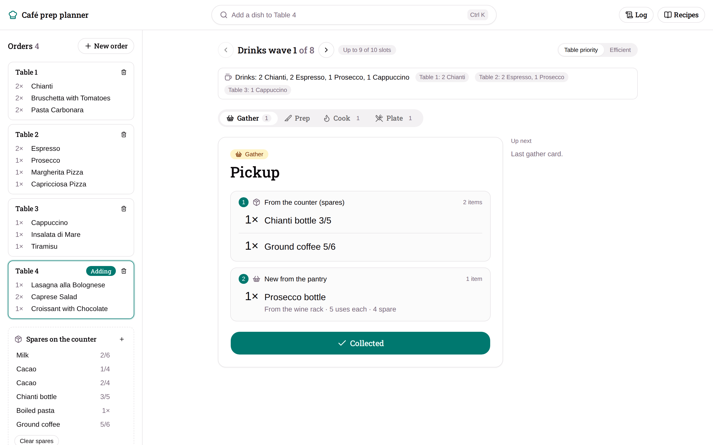
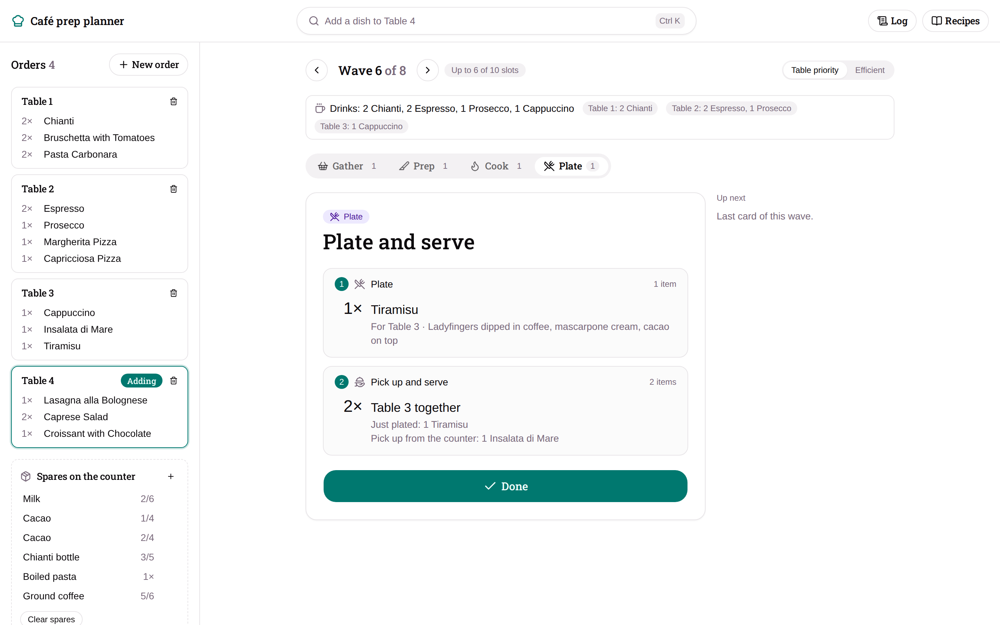
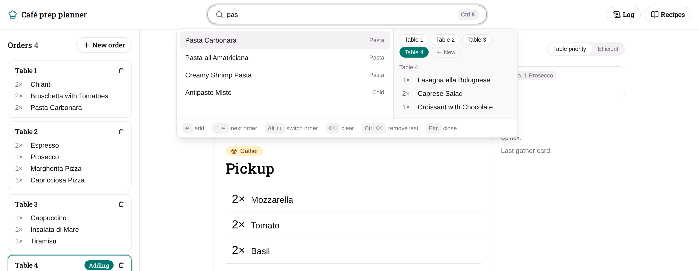
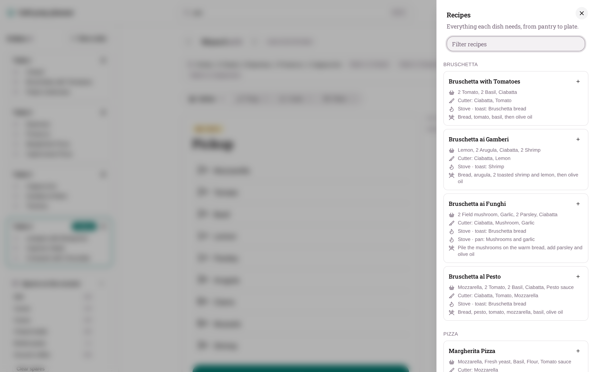
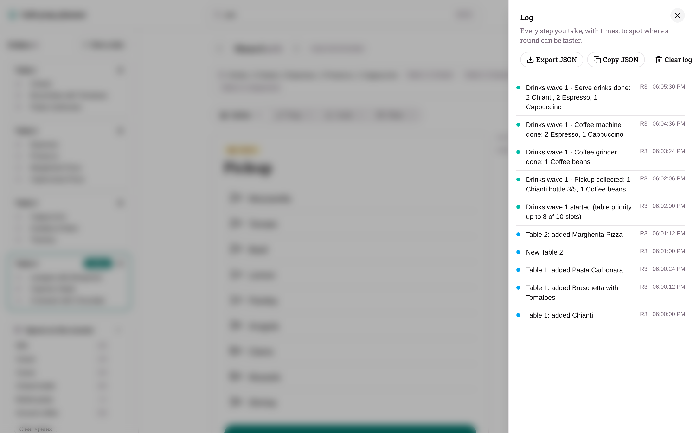

<h1 align="center">Café prep planner</h1>

<p align="center">
  An order planner for <a href="https://store.steampowered.com/app/3196440/">Vacation Cafe Simulator</a>.<br>
  Type in your tables' orders and get one step-by-step plan that fits in your 10 inventory slots:
  <b>Gather → Prep → Cook → Plate</b>.
</p>

<p align="center">
  <a href="https://sandercokart.github.io/vacation-cafe-simulator-order-planner/"><b>Open the planner in your browser →</b></a>
</p>

<p align="center">
  <picture>
    <source media="(prefers-color-scheme: dark)" srcset="docs/screenshots/pickup-dark.png">
    
  </picture>
</p>

## Why

A busy service in Vacation Cafe Simulator means juggling a dozen dishes across stations with only 10 inventory slots. This planner works it all out for you:
- what to grab from the pantry and from the counter
- what to cut, grate, mix and roll, and in which order
- what goes in the pan, pot, oven and coffee machine
- which plates to serve now, and which to set aside until a table is complete

## Features

- **Quick order entry.** Press <kbd>/</kbd> or <kbd>Ctrl</kbd> <kbd>K</kbd>, type a few letters and press <kbd>Enter</kbd>. The most direct matches come first.
- **One card per station.** Work is combined across every table, so you cut all the tomatoes in one go. The mixer, oyster table and coffee machine tell you how to batch.
- **Waves that fit in your hands.** The planner counts slots for stacks, partial containers, filled cups and plated dishes, and splits the round into waves that never need more than 10.
- **Table priority or Efficient.** Drinks for every table go first. Then tables are finished in order, or packed for the fewest trips.
- **Serve whole tables.** Dishes for an unfinished table go aside on the counter. The wave that completes the table tells you exactly what to pick back up.
- **Spares that remember.** Leftover milk, cacao, wine and boiled pasta are tracked container by container (Cacao 1/4, Chianti 3/5) and used emptiest first.
- **Pantry order.** The pickup list follows the shelves from left to right.
- **Recipe library and step log.** Look up any dish, and export a timestamped log of every step to find faster routes.
- **Saved in your browser.** Progress survives a refresh, and the app follows your system's light or dark theme.

<table>
  <tr>
    <td width="50%">
      <picture>
        <source media="(prefers-color-scheme: dark)" srcset="docs/screenshots/plate-dark.png">
        
      </picture>
      <p align="center"><b>Serve tables together</b></p>
    </td>
    <td width="50%">
      <picture>
        <source media="(prefers-color-scheme: dark)" srcset="docs/screenshots/search-dark.png">
        
      </picture>
      <p align="center"><b>Spotlight-style order entry</b></p>
    </td>
  </tr>
  <tr>
    <td width="50%">
      <picture>
        <source media="(prefers-color-scheme: dark)" srcset="docs/screenshots/recipes-dark.png">
        
      </picture>
      <p align="center"><b>Recipe library</b></p>
    </td>
    <td width="50%">
      <picture>
        <source media="(prefers-color-scheme: dark)" srcset="docs/screenshots/log-dark.png">
        
      </picture>
      <p align="center"><b>Step log</b></p>
    </td>
  </tr>
</table>

## Getting started

The planner runs in your browser at **https://sandercokart.github.io/vacation-cafe-simulator-order-planner/**. Nothing to install, and your progress is saved locally.

To run it yourself, you need [Node.js](https://nodejs.org) 22 or newer and [pnpm](https://pnpm.io).

```bash
pnpm install
pnpm dev
```

Then open the URL Vite prints, usually http://localhost:5173.

## Keyboard shortcuts

| Key | What it does |
|---|---|
| <kbd>/</kbd> or <kbd>Ctrl</kbd> <kbd>K</kbd> | Focus the search field |
| <kbd>Enter</kbd> | Add the highlighted dish (press again to add another) |
| <kbd>Shift</kbd> <kbd>Enter</kbd> | Start the next order |
| <kbd>Alt</kbd> <kbd>↑</kbd> / <kbd>Alt</kbd> <kbd>↓</kbd> | Switch between orders |
| <kbd>Backspace</kbd> | Clear the search field |
| <kbd>Ctrl</kbd> <kbd>Backspace</kbd> | Remove one of the last added dish |
| <kbd>Esc</kbd> | Close the search |

Click an order's name to give it a table number.

## How the planner works

1. **Recipes become processes.** Every dish breaks down into station steps: "slice tomato", "mix pasta dough", "boil fresh pasta". Each step consumes items and makes items, with batch yields where the game has them: 1 ciabatta makes 2 bruschettas, 1 coffee grind fills a 6-shot can, and 1 pot of pasta serves 2.
2. **Demand is added up and worked backwards.** The orders' plates are totalled, and each step runs as often as needed, after using what's already on the counter.
3. **Waves are packed.** The planner walks each candidate wave through gather, every station and plating, counting inventory slots at every step. It keeps 1 slot free for the basic cutting table, and fills the wave as far as 10 slots allow. Dishes that share a batch stay together.
4. **Serving is planned per table.** Food for a table that isn't complete goes aside on the counter. When its last dish is plated, the card lists everything to carry to the table.

The design decisions behind all this are in [docs/decisions.md](docs/decisions.md).

## Project structure

```
src/
  data/        items, station processes and recipes (the game data)
  lib/         planner, inventory slots, waves, spares and search, with tests
  components/  the UI (shadcn/ui on Base UI)
  store.ts     orders, wave progress, spares and the step log (zustand, saved to localStorage)
docs/          decisions, recipe source data, TODO and screenshots
scripts/       headless screenshot generator
```

### Adding a recipe

1. Add any new ingredients to `src/data/items.ts`, and to `PICKUP_ORDER` if they sit on the pantry shelves.
2. Add a process to `src/data/processes.ts` for every prep or cook step that makes something new.
3. Add the dish to `src/data/recipes.ts`. Its `plate` lists what plating uses.
4. Run `pnpm test`.

Recipes that aren't unlocked or confirmed yet are listed in [docs/TODO.md](docs/TODO.md). Corrections from the game are very welcome.

## Scripts

| Command | What it does |
|---|---|
| `pnpm dev` | Start the dev server |
| `pnpm build` | Type-check and build for production |
| `pnpm test` | Run the planner tests (Vitest) |
| `pnpm lint` | Lint with ESLint |
| `pnpm screenshots` | Regenerate the README screenshots with headless Chromium |

Every push to `main` is tested, built and deployed to GitHub Pages by [.github/workflows/deploy.yml](.github/workflows/deploy.yml).

The screenshot script builds the app, loads a demo café with four tables, and captures every screen in light and dark, plus a 1280×640 `social-preview.png` for GitHub. Before the first run, install the browser with `pnpm exec playwright install chromium`.

## Built with

[Vite](https://vite.dev), [React](https://react.dev), [TypeScript](https://www.typescriptlang.org), [Tailwind CSS](https://tailwindcss.com), [shadcn/ui](https://ui.shadcn.com), [zustand](https://zustand.docs.pmnd.rs), [@wrksz/themes](https://themes.wrksz.dev), [Vitest](https://vitest.dev) and [Playwright](https://playwright.dev).

## License

[MIT](LICENSE) © 2026 Sander Cokart

## Disclaimer

This is a fan-made tool. It isn't affiliated with or endorsed by Alice Games, the developer of Vacation Cafe Simulator. Recipe data comes from playing the game and may lag behind updates.
